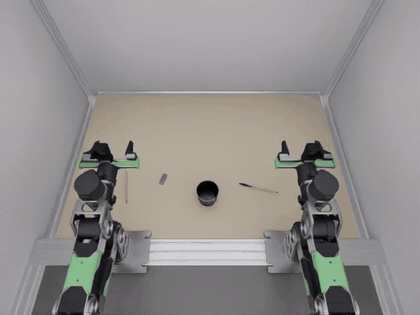

# reBot Duo: Sim-to-Policy, the course

A hands-on course for two Seeed reBot B601 arms that put two pens and an
eraser into a pencil cup. You build the scene in simulation, record
demonstrations, train a vision-language-action model, serve it, and run it with
hardware in the loop: the simulator on a Dell Pro Max workstation and the model
on an NVIDIA Jetson AGX Thor.

**Live course:** https://kabilankb.github.io/rebot-duo-course/



## Modules

| # | Module | What you do |
|---|---|---|
| 0 | Workstation setup | Isaac Lab 3 / Isaac Sim 6, LeRobot, vla-edge on a Dell Pro Max 16 Plus (RTX PRO 5000 Blackwell) |
| 1 | The bimanual scene | Two reBot B601 arms, a top camera and two wrist cameras, CPU physics at 30 Hz |
| 2 | Data collection | 52 scripted demonstrations, 70,884 frames, LeRobot v3 format |
| 3 | Training on different models | SmolVLA fine-tuned for 20k steps; ACT and π0.5 recipes |
| 4 | Inference & evaluation | Serve a checkpoint over `POST /act` and evaluate on layouts the model never saw |
| 5 | Hardware-in-the-loop on Jetson Thor | Simulator on the Dell, every action chunk computed on the Thor |
| — | Wire format | State and action conventions shared by the dataset, the server and the arms |

## Results so far

| Run | Layouts | Success | Inference per chunk |
|---|---|---|---|
| Replay of a recorded episode (sanity check) | 1 | 1 / 1 | 1.3 ms |
| SmolVLA step 20k, served on the Dell | seeds 1000–1004 | 0 / 5 | ≈ 160 ms |
| SmolVLA step 20k, served on the Jetson Thor | seeds 1000–1019 | 1 / 20 | ≈ 278 ms |

The policy reaches, grasps and carries objects on new layouts but rarely
releases them. The Thor and the Dell fail the same way, so the gap is in the
training, not the hardware.

## Code

The package this course uses is
[`package/`](package/) (`rebot-bimanual-vla`).

## Layout

```
index.html   the course, one self-contained page (Google Fonts are the only external request)
media/       GIFs and images the page shows
.nojekyll    tells GitHub Pages to serve the files as they are
package/     the rebot-bimanual-vla Python package: embodiment, SmolVLA runtime, sim client, tests
```

## License

Apache-2.0, see `LICENSE`.
